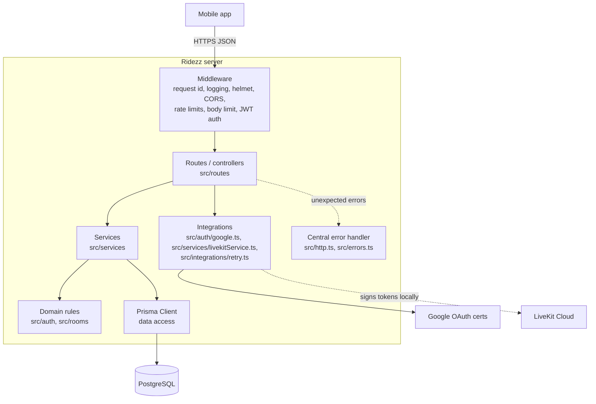

# Backend architecture

The server is a single stateless Node.js process (Express + Prisma) in a layered architecture.
It is deliberately small: one PostgreSQL database, no cache, no queue and no background workers,
because no current workload needs them (see the decisions below).

## Layers

| Layer        | Rule                                                                                  |
| ------------ | ------------------------------------------------------------------------------------- |
| Middleware   | Cross-cutting concerns only; no business decisions                                    |
| Routes       | Parse and validate input, call one service, map its tagged result to a status and DTO |
| Services     | Business use cases; return tagged results (`{ kind: 'duplicate' }`), never HTTP types |
| Domain rules | Pure functions with no I/O (validation, allow list, room-code format, destinations)  |
| Integrations | All calls to third parties, with timeouts and bounded retries                         |
| Data access  | Prisma only, called from services (and the health check)                              |

Dependencies are injected: `createApp({ prisma, env, verifyGoogleIdToken })` receives the database
client, the validated configuration and the Google verifier, and every router is built from them.
Tests pass fakes for each.

### Data transfer objects

Database rows never leave the server. `toAuthUser` maps `User` to the public `User` DTO (without
the password hash or Google id), and the rooms router builds `RoomAccess` and `Destination`
responses field by field.

## Request lifecycle

1. `requestIdMiddleware` accepts a safe `x-request-id` or generates a UUID and echoes it.
2. `requestLogger` logs `http_request` with method, path (no query string), status and duration.
3. Security middleware: helmet headers, CORS, per-IP and per-account rate limits, 32 KB JSON limit.
4. Passport verifies the JWT and loads the rider (five columns) for protected routes, rejecting
   accounts no longer on the allow list.
5. The route validates input and calls a service; expected outcomes become `{ message, code }`
   errors via `sendError`.
6. Anything unexpected reaches the central error handler, which logs it with secrets redacted
   and returns a generic `500 INTERNAL_ERROR`.

## External integrations

| Dependency       | Used for                       | Failure handling                                                       |
| ---------------- | ------------------------------ | ---------------------------------------------------------------------- |
| PostgreSQL       | Accounts and rooms             | Readiness check returns `503`; requests fail with `500` and are logged |
| Google OAuth     | Verifying Google ID tokens     | 5 s timeout, 3 attempts with exponential backoff and full jitter for network errors, 429 and 5xx only; then `503 SERVICE_UNAVAILABLE`. Invalid tokens are never retried |
| LiveKit          | Voice rooms                    | Tokens are signed locally with the API secret; no network call         |

## Decisions

| # | Decision | Status | Reason |
| - | -------- | ------ | ------ |
| 1 | Layered architecture with Prisma as the data-access layer, no separate repository classes | Accepted | Prisma Client already is a typed repository per model. Wrapping it in a second layer would duplicate every query without adding a seam: services are already tested with Prisma-shaped fakes and against a real database. Revisit if a second data store or complex queries appear. |
| 2 | Tagged results from services instead of exceptions | Accepted | Expected outcomes (duplicate email, wrong host) are part of the contract and are checked exhaustively by TypeScript. Exceptions are reserved for unexpected failures. |
| 3 | One error body, `{ message, code }` | Accepted | Riders see `message`; the app branches on `code`. Codes are listed in the OpenAPI document and checked by a test. |
| 4 | `/api/v1` with `/api` kept as an alias | Accepted | Versioning without breaking released app builds. |
| 5 | JWT access tokens (HS256, 30 days) without refresh tokens | Accepted, revisit | Riders stay signed in for long rides without a refresh round-trip on bad connections. Revocation is still possible: the allow list is checked on every request. Add refresh tokens with short-lived access tokens before opening sign-up publicly. |
| 6 | Authorization by ownership, no roles | Accepted | The only privileged action is changing a room's destination, which is limited to the host on the server. Add roles when an admin function exists. |
| 7 | No cache (Redis), queue or background jobs | Accepted | Every request is a few indexed single-row operations, and nothing is long-running. Introduce them when a workload needs them, not before. |
| 8 | No circuit breaker | Accepted | The only remote dependency on the request path is Google certificate fetching, which the library caches; bounded retries and timeouts are sufficient. |
| 9 | Stateless process | Accepted | No in-memory session state, so instances can be scaled horizontally. Rate-limit counters are per process; move them to a shared store (Redis) if more than one instance runs. |
| 10 | CORS closed by default outside development | Accepted | The only client is a native app, which sends no `Origin`. Browser clients must be listed in `CORS_ORIGINS`. |
