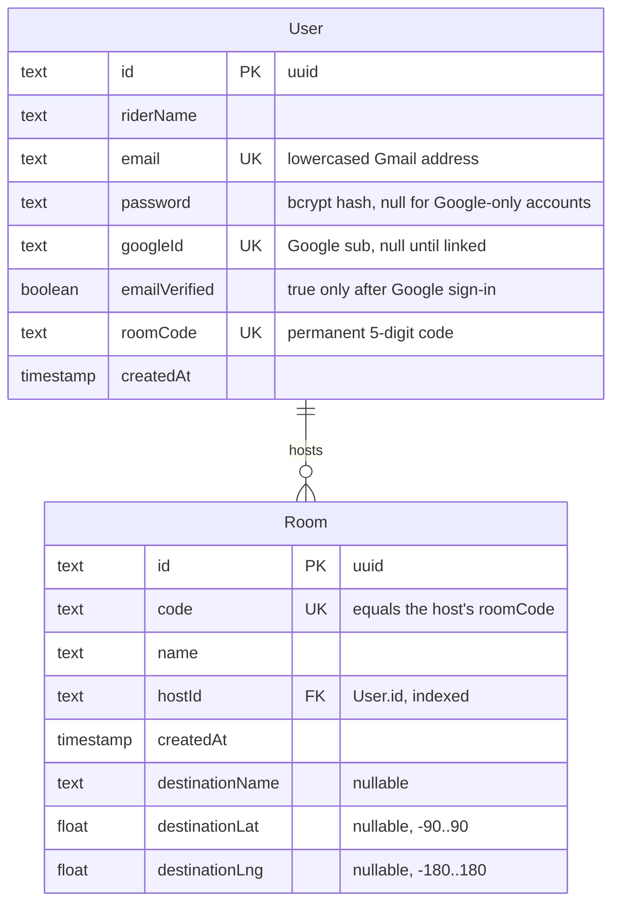

# Database

PostgreSQL 16, accessed only through Prisma (`server/prisma/schema.prisma`). Prisma builds
parameterized queries, so no SQL is assembled from user input anywhere in the code base.

## Schema



### Constraints and indexes

| Table  | Constraint / index        | Why                                                      |
| ------ | ------------------------- | -------------------------------------------------------- |
| `User` | `email` unique            | One account per address; sign-in looks users up by email |
| `User` | `googleId` unique         | One account per Google identity                          |
| `User` | `roomCode` unique         | Room codes identify a rider; races are caught here and retried |
| `Room` | `code` unique             | Joins look rooms up by code                              |
| `Room` | `hostId` index            | Foreign key lookups and host checks                      |
| `Room` | `hostId` → `User.id`      | `ON DELETE RESTRICT`: a rider with rooms cannot be deleted by accident |

Validation ranges (name lengths, coordinates) are enforced in the API layer before any write.

## Access patterns

Every request touches at most a few rows, each by a unique or indexed key: there are no list
endpoints, joins or N+1 patterns. Authenticated requests load only the five user columns they need
(never the password hash). Writes that must be atomic use single statements: `upsert` for hosting
a room, and a conditional `updateMany ... WHERE roomCode IS NULL` so concurrent first requests
agree on one room code.

## Migrations

Schema changes go through Prisma Migrate and are reviewed like code:

```sh
npm run prisma:migrate:dev -- --name describe_the_change
npm run prisma:migrate:deploy
```

| Migration                              | Change                    |
| -------------------------------------- | ------------------------- |
| `20261002_postgresql_baseline`         | Initial PostgreSQL schema |
| `20261104000000_add_room_host_index`   | Index on `Room.hostId`    |

Rules:

- Never edit a migration that has been applied anywhere; add a new one.
- Prefer additive changes (new tables, nullable columns) so the previous release still runs
  against the new schema, which keeps rollbacks possible. Drop columns in a later release.
- Large-table index builds should use `CREATE INDEX CONCURRENTLY` in a hand-edited migration.

## Connections

Prisma keeps a connection pool per process. Its size defaults to `num_cpus * 2 + 1`; set it
explicitly with `connection_limit` in `DATABASE_URL` so that
`instances * connection_limit` stays below the database's connection limit. Use TLS
(`sslmode=require`) outside local development.

## Backup and recovery

- Use the provider's automated daily backups with point-in-time recovery for staging and
  production, kept for at least 7 days.
- Take a manual snapshot (or `pg_dump --format=custom`) before every production migration.
- Test a restore into a scratch database at least once a quarter: restore, run
  `npm run prisma:migrate:deploy` (it should report nothing to apply), then start the server
  against it and check `GET /health/ready`.
